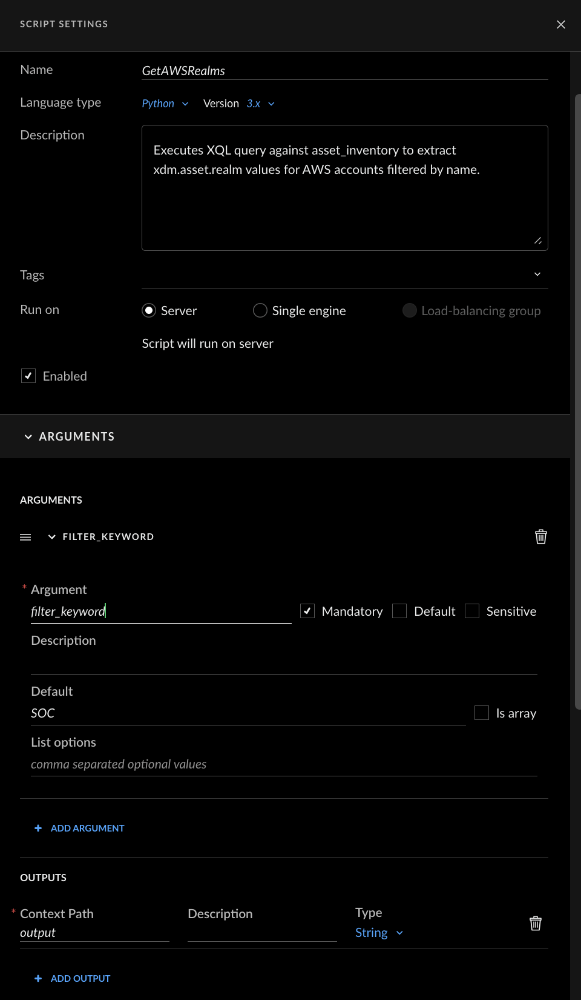
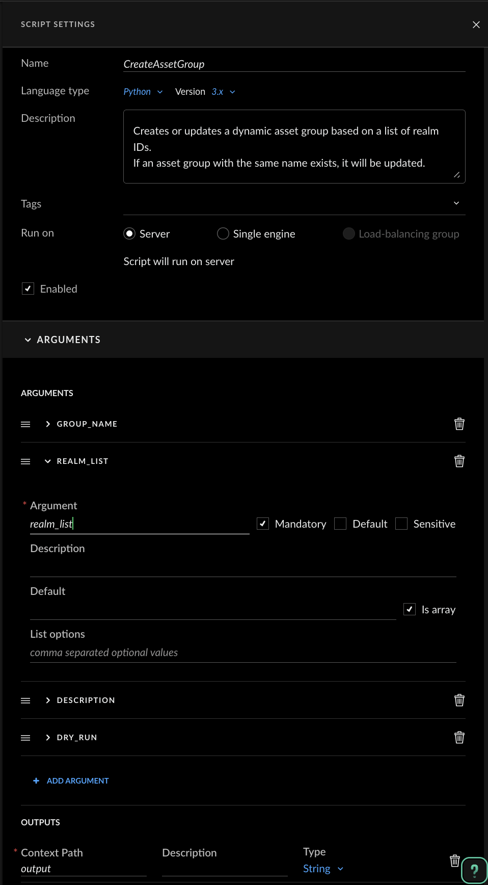

# Cortex Cloud Custom Scripts

This repository contains custom automation scripts for Cortex Cloud. These scripts work together to filter cloud accounts — by name or by tag — and create dynamic asset groups based on the results. Works with any cloud provider (AWS, Azure, GCP).

There are two ways to select accounts, each paired with the same `CreateAssetGroup` script:

- **By name:** `GetCloudAccounts` (Cloud Onboarding APIs, filters on account name)
- **By tag:** `GetCloudAccountsByTag` (Assets API, filters on a tag key/value)

`CreateApplication` builds AppSec Business Applications from the accounts that carry a tag. It is self-contained: it runs the same XQL tag lookup as `GetCloudAccountsByTag` itself.


---

## How to Create Scripts in Cortex

1. In Cortex, navigate to **Investigation & Response → Automation → Scripts**
2. Click the **+ New Script** button in the top right corner
3. Delete the example code and paste the script content from this repository
4. Configure the script settings in the right panel (described below for each script)
5. Click **Save** when done

---

## Script 1: GetCloudAccounts

Retrieves cloud account IDs filtered by account name using the Cloud Onboarding APIs. Works with any cloud provider (AWS, Azure, GCP) based on the integration instance.

### Script Settings

| Field | Value |
|-------|-------|
| **Name** | `GetCloudAccounts` |
| **Description** | Retrieves cloud account IDs filtered by account name using Cloud Onboarding APIs. Works with any cloud provider. |

### Input Arguments

| Argument | Type | Required | Default | Description |
|----------|------|----------|---------|-------------|
| `instance_ids` | Array | Yes | — | One or more cloud integration instance IDs (also known as Connector ID in Cortex Cloud) |
| `filter_keyword` | String | No | — | Filter expression with optional flag prefix (see below) |
| `case_sensitive` | Boolean | No | `false` | Enable case-sensitive matching |
| `debug` | Boolean | No | `false` | Show debug info in output |

> **Important:** For the `instance_ids` argument, enable the **"Is array"** checkbox in the script configuration to accept multiple values.

### Filter Syntax

| Flag | Example | Description |
|------|---------|-------------|
| (none) | `SOC` | Simple contains match |
| `-r` | `-r ^AWS-SOC.*` | Regex pattern match |
| `-or` | `-or SOC, PROD, DEV` | Match ANY keyword (comma-separated) |
| `-and` | `-and SOC, Production` | Match ALL keywords (comma-separated) |

### Output

| Context Path | Type | Description |
|--------------|------|-------------|
| `GetCloudAccounts.values` | List | List of cloud account IDs matching the filter |
| `GetCloudAccounts.account_names` | List | List of account names matching the filter |
| `GetCloudAccounts.results_count` | Number | Count of accounts found |
| `GetCloudAccounts.instance_ids` | List | The instance IDs queried |
| `GetCloudAccounts.filter_keyword` | String | The filter expression used |
| `GetCloudAccounts.case_sensitive` | Boolean | Whether case-sensitive matching was used |

### Configuration Screenshot Reference



---

## Script 1b: GetCloudAccountsByTag

Retrieves cloud account IDs (AWS Account, Azure Subscription, GCP Project) that carry a specific tag, using a **single XQL query** on the `asset_inventory` dataset (`xdr-xql-generic-query`). By default all three providers are scanned; use `cloud_provider` to narrow the scan to one or more of them (applied in the query itself). The provider → asset type mapping is fixed (`ASSET_TYPE_BY_PROVIDER` in the script).

> **Requires** the **Cortex XDR - XQL Query Engine** integration to be enabled (it provides `xdr-xql-generic-query` and `xdr-xql-get-query-results`). Each run consumes XQL query quota.

Each provider keeps its tags in a different place inside `xdm.asset.raw_fields`; the query extracts all of them in one pass:

| Provider | Where tags live | Query column |
|----------|------------------|--------------|
| AWS Account | `raw_fields["Platform Discovery"]["Tags"]` (list of `{Key, Value}`) | `tags_aws` (converted to `{key: value}` by the script) |
| Azure Subscription | `raw_fields["Platform Discovery"]["tags"]` (object) | `tags_azure` |
| GCP Project | `raw_fields["Platform Discovery"]["labels"]` (object) | `tags_gcp` |

Tag matching (key, optional values, case sensitivity) is then done by the script on the query results. The query is the `XQL_QUERY_TEMPLATE` constant in the script; if a provider's tag location ever changes, that's the place to update.

### Script Settings

| Field | Value |
|-------|-------|
| **Name** | `GetCloudAccountsByTag` |
| **Description** | Retrieves cloud account IDs filtered by tag key/value using an XQL query on asset_inventory. Works with AWS, Azure and GCP. |

### Input Arguments

| Argument | Type | Required | Default | Description |
|----------|------|----------|---------|-------------|
| `tag_key` | String | Yes | — | Tag key to look for |
| `tag_value` | Array | No | — | Tag values to match (any of them). If empty, any account with the key matches, regardless of value |
| `cloud_provider` | Array | No | — | Cloud providers to scan: `AWS`, `Azure`, `GCP` (case-insensitive, comma-separated). If empty, all providers are scanned. Unknown values fail the script |
| `case_sensitive` | Boolean | No | `false` | Enable case-sensitive matching on key and value |
| `debug` | Boolean | No | `false` | Show debug info (the XQL query, row counts, tags that could not be parsed) in output |

> **Important:** For the `tag_value` and `cloud_provider` arguments, enable the **"Is array"** checkbox in the script configuration to accept multiple values.
>
> `case_sensitive` applies only to the tag key/value; `cloud_provider` is always case-insensitive.
>
> **Limitation:** because `tag_value` is an array, commas are treated as value separators. A tag whose value literally contains a comma (e.g. `Sales, Marketing`) is read as two separate values and cannot be matched literally.

### Output

| Context Path | Type | Description |
|--------------|------|--------------|
| `GetCloudAccountsByTag.values` | List | List of `xdm.asset.cloud.account.id` matching the tag (deduplicated) |
| `GetCloudAccountsByTag.account_names` | List | List of matching account names |
| `GetCloudAccountsByTag.accounts_by_provider` | Object | The same account IDs grouped by provider: `{"AWS": [...], "AZURE": [...], "GCP": [...]}` |
| `GetCloudAccountsByTag.results_count` | Number | Count of accounts found |
| `GetCloudAccountsByTag.tag_key` | String | The tag key used |
| `GetCloudAccountsByTag.tag_value` | List | The tag values used |
| `GetCloudAccountsByTag.cloud_provider` | List | The cloud providers requested (empty = all) |
| `GetCloudAccountsByTag.failed_lookups` | List | Account IDs whose tags could not be parsed (unexpected format in the query results) — **excluded** from `values`. Review these before trusting the result; such an account may actually have the tag |

### A note on XQL query time and limits

- The query is asynchronous. If `xdr-xql-generic-query` returns while it is still pending, the script polls `xdr-xql-get-query-results` every `XQL_POLL_INTERVAL_SECONDS` (10s) for up to `XQL_TIMEOUT_SECONDS` (300s). Keep the script **timeout** in Cortex above that.
- The query runs over `XQL_TIME_FRAME` (`7 days`).
- If the query reports more results than it returned (`number_of_results` greater than the rows received), the output shows a warning that the result may be incomplete.

---

## Script 2: CreateAssetGroup

Creates or updates a dynamic asset group in Cortex XSIAM based on a list of cloud account IDs. If a group with the specified name already exists, it will be updated; otherwise, a new group is created.

It uses the platform's native asset group commands instead of direct API calls:

| Step | Command |
|------|---------|
| Look up an existing group by name | `getAssetGroup` (`names`) |
| Create a new group | `createAssetGroup` (`group_name`, `group_type=Dynamic`, `group_description`, `membership_json`) |
| Update the existing group | `setAssetGroup` (`group_id` + the same arguments) |

The membership filter sent in `membership_json` matches `xdm.asset.realm` against every account in `account_ids` (OR) — for AWS, Azure and GCP account-level assets `xdm.asset.realm` equals the cloud account ID.

### Script Settings

| Field | Value |
|-------|-------|
| **Name** | `CreateAssetGroup` |
| **Description** | Creates or updates a dynamic asset group based on a list of cloud account IDs. Supports dry-run mode to preview changes. |

### Input Arguments

| Argument | Type | Required | Default | Description |
|----------|------|----------|---------|-------------|
| `group_name` | String | Yes | — | Name of the asset group to create or update |
| `account_ids` | Array | Yes | — | List of cloud account IDs (output of `GetCloudAccounts` or `GetCloudAccountsByTag`) |
| `group_description` | String | No | *Auto-generated* | Description for the asset group |
| `dry_run` | Boolean | No | `false` | If true, only shows what would be done without making changes |
| `debug` | Boolean | No | `false` | Show the arguments and raw results of each command in the output |

> **Important:** For the `account_ids` argument, you must enable the **"Is array"** checkbox in the UI. This allows the script to receive a list of values instead of a single string.

> **Tip:** For `account_ids`, reference `${GetCloudAccounts.values}` or `${GetCloudAccountsByTag.values}` when chaining the scripts in a playbook.

### Output

| Context Path | Type | Description |
|--------------|------|-------------|
| `CreateAssetGroup.group_id` | String | The asset group ID |
| `CreateAssetGroup.group_name` | String | The asset group name |
| `CreateAssetGroup.action` | String | Action performed (created/updated/would be created/would be updated) |
| `CreateAssetGroup.account_count` | Number | Number of accounts included in the group |
| `CreateAssetGroup.status` | String | Execution status (success/dry_run) |

### Configuration Screenshot Reference



---

## Script 3: CreateApplication

Creates or updates AppSec **Business Applications** from the cloud accounts that carry a given tag. It finds the accounts with the same single XQL query as `GetCloudAccountsByTag` (embedded in the script, so it doesn't depend on it), groups them by provider and creates one application per provider, using the AppSec Applications API (`/public_api/appsec/v1/application`) through `core-api-get` / `core-api-post` / `core-api-put` / `core-api-delete`.

> **Required license:** Cortex Cloud Posture Management or Cortex Cloud Runtime Security with the Application Security add-on.
>
> **Requires** the **Cortex XDR - XQL Query Engine** integration (for the tag lookup) and the Core REST API commands `core-api-get` / `core-api-post` / `core-api-put` / `core-api-delete`.

### Naming: one application per provider

An application's asset filter takes a single provider, so:

| Tagged accounts found in | Applications created/updated |
|---|---|
| One provider (e.g. only AWS) | One, named exactly `application_name` |
| Several providers (e.g. AWS and GCP) | One per provider: `<application_name> - AWS`, `<application_name> - GCP` |

The suffix format is the `APP_NAME_FORMAT` constant in the script. If the provider mix changes between runs (e.g. `Sales` was created when only AWS matched, and now GCP matches too, so `Sales - AWS` and `Sales - GCP` are created), the old application is **not** touched; the output lists it so you can review and delete it.

Each application selects its assets with a `run` section `ACCOUNT` filter:

```json
{"selectionType": "filter", "section": "run",
 "filter": {"filterType": "ACCOUNT", "provider": "AWS", "values": ["111111111111", "222222222222"]}}
```

### Updating: the account list can't be changed in place

The update API (`PUT /application/{id}`) only accepts metadata (criticality, owners, description...), **not** the asset selection. When an application already exists and its accounts differ from the tagged ones:

| `recreate_on_change` | What happens |
|---|---|
| `false` (default) | Metadata is updated; the account selection is left as is and a warning is returned |
| `true` | The application is deleted and created again with the new accounts. Its metadata is carried over, but it gets a **new application ID** and manual asset overrides are lost. If the create fails after the delete, the application is gone, so run with `dry_run=true` first |

### Script Settings

| Field | Value |
|-------|-------|
| **Name** | `CreateApplication` |
| **Description** | Creates or updates Business Applications from the cloud accounts that carry a tag, one per cloud provider. |

### Input Arguments

| Argument | Type | Required | Default | Description |
|----------|------|----------|---------|-------------|
| `application_name` | String | Yes | — | Application name (name prefix when accounts span several providers) |
| `tag_key` | String | Yes | — | Tag key to look for |
| `tag_value` | Array | No | — | Tag values to match (any of them). If empty, any value matches |
| `cloud_provider` | Array | No | — | `AWS`, `Azure`, `GCP` (case-insensitive). If empty, all providers are scanned |
| `case_sensitive` | Boolean | No | `false` | Case-sensitive tag key/value matching |
| `business_criticality` | String | No | `Medium` on create | `Critical`, `High`, `Medium` or `Low`. On update, only changed when provided |
| `description` | String | No | — | Application description |
| `business_unit` | String | No | — | Business unit |
| `compliance` | String | No | — | `PCI-DSS`, `ISO 27001`, `SOX`, `NIST`, `GDPR`, `CCPA`, `HIPAA` or `FedRAMP` |
| `business_owner` | Array | No | — | Business owners |
| `dev_owner` | Array | No | — | Development owners |
| `devops_owner` | Array | No | — | DevOps owners |
| `product_manager` | Array | No | — | Product managers |
| `recreate_on_change` | Boolean | No | `false` | Delete and recreate when the accounts changed (see above) |
| `dry_run` | Boolean | No | `false` | Only show what would be done (includes the debug info) |
| `debug` | Boolean | No | `false` | Show the API requests and responses in output |

> **Important:** Enable **"Is array"** for `tag_value`, `cloud_provider` and the four owner arguments.
>
> Metadata arguments that are left empty are never sent, so an update doesn't blank out existing values.

### Output

One context entry per application:

| Context Path | Type | Description |
|--------------|------|-------------|
| `CreateApplication.application_id` | String | The application ID (new ID when recreated) |
| `CreateApplication.application_name` | String | The application name |
| `CreateApplication.provider` | String | `AWS`, `AZURE` or `GCP` |
| `CreateApplication.action` | String | `created`, `updated`, `recreated`, `unchanged` (exists, no metadata to update) or `failed`; `would be ...` in dry run |
| `CreateApplication.account_ids` | List | Tagged accounts for this provider |
| `CreateApplication.account_count` | Number | Number of tagged accounts for this provider |
| `CreateApplication.accounts_changed` | Boolean | Whether they differ from the existing application's selection |
| `CreateApplication.accounts_added` | List | Tagged accounts missing from the existing application (before this run) |
| `CreateApplication.accounts_removed` | List | Accounts in the existing application that are no longer tagged (before this run) |
| `CreateApplication.status` | String | `success`, `warning`, `failed` or `dry_run` |
| `CreateApplication.message` | String | Warning or error text, if any |

One application failing doesn't stop the others; the script only returns an error when all of them failed. If no account matches the tag, nothing is created and the output says so.

---

## Usage Example: Chaining Scripts in a Playbook

Both account-selection scripts feed the same `CreateAssetGroup` script; pick whichever matches how you want to select accounts. A typical workflow:

1. **Run GetCloudAccounts or GetCloudAccountsByTag** to get the list of cloud account IDs
2. **Run CreateAssetGroup** using the account list from step 1 to create/update a dynamic asset group

> Because `xdm.asset.realm` equals `xdm.asset.cloud.account.id` for AWS, Azure and GCP account-level assets, the account IDs returned by either script can be passed straight into `CreateAssetGroup`'s `account_ids`.

### Example Playbook Flow — by name

```
┌───────────────────────────────────────────┐
│           GetCloudAccounts                │
│   instance_ids: ["aws-inst", "gcp-inst"]  │
│   filter_keyword: "-or SOC; PROD"         │
│   Output: GetCloudAccounts.values         │
└────────────────────┬──────────────────────┘
                     │
                     ▼
┌───────────────────────────────────────────┐
│         CreateAssetGroup                  │
│   group_name: "SOC Cloud Accounts"        │
│   account_ids: ${GetCloudAccounts.values} │
│   dry_run: false                          │
└───────────────────────────────────────────┘
```

### Example Playbook Flow — by tag

```
┌─────────────────────────────────────────────┐
│         GetCloudAccountsByTag               │
│   tag_key: "c7n-product"                    │
│   tag_value: ["Sales"]                      │
│   Output: GetCloudAccountsByTag.values      │
└────────────────────┬────────────────────────┘
                     │
      ┌──────────────┴───────────────┐
      │ results_count > 0 ?           │
      └──────────────┬───────────────┘
                     │ yes
                     ▼
┌───────────────────────────────────────────────┐
│            CreateAssetGroup                    │
│   group_name: "Sales Cloud Accounts"          │
│   account_ids: ${GetCloudAccountsByTag.values} │
│   dry_run: false                              │
└─────────────────────────────────────────────────┘
```

> **Tip:** `CreateAssetGroup` requires a non-empty `account_ids`. Since a tag might match zero accounts, add a condition on `GetCloudAccountsByTag.results_count > 0` (or check `values` is not empty) before the `CreateAssetGroup` task, so the playbook fails gracefully instead of erroring out.

---

## Troubleshooting

### GetCloudAccounts returns no results
- Run with `debug="true"` to see detailed API response info
- Verify the instance_id is correct and the integration is active
- Check that the filter_keyword matches actual account names
- If using regex (`-r`), verify the pattern is valid

### CreateAssetGroup fails with API errors
- Verify you have permissions to create/modify asset groups
- Check that `account_ids` is not empty
- Use `dry_run: true` first to preview what would be created
- Run with `debug: true` to see the raw results of `getAssetGroup` / `createAssetGroup` / `setAssetGroup`
- If the script fails with the generic *"failed to run script with default configuration"*, the underlying builtin command most likely returned an error that the platform didn't pass through to the script. Run the same command directly in the War Room to see the real reason, e.g.:
  ```
  !createAssetGroup group_name="test" group_type="Dynamic" membership_json=`{"AND":[{"OR":[{"SEARCH_FIELD":"xdm.asset.realm","SEARCH_TYPE":"WILDCARD","SEARCH_VALUE":"<account_id>"}]}]}`
  ```
- `409 – Maximum number of Asset Groups exceeded` means the tenant hit its asset group limit; no group can be created (by the script, API or UI) until some are removed
- If it fails with *"Found group ... but could not extract its ID"*, the command returned the ID under a field name the script doesn't know: check the field list in the error and add it to `GROUP_ID_KEYS` in the script

### API returns fewer accounts than expected
- The script automatically handles pagination to fetch all accounts
- Run with `debug="true"` to see pagination details

### GetCloudAccountsByTag returns no results
- Run with `debug="true"` to see the exact XQL query, how many rows it returned and how many matched
- Run the query from the debug output in the XQL Query Builder to inspect the `tags_aws` / `tags_azure` / `tags_gcp` columns for the accounts you expect
- Check `GetCloudAccountsByTag.failed_lookups` — a non-empty list means some accounts' tags couldn't be parsed and may be missing from the result
- Confirm `tag_key` (and `tag_value`, if set) match the real tag casing, or set `case_sensitive=false` (the default)
- If it fails with `xdr-xql-generic-query: ...`, check that the Cortex XDR - XQL Query Engine integration is enabled

### CreateApplication fails or doesn't apply the new accounts
- Run with `dry_run=true` first: it shows, per provider, the application name, the action and the asset selection that would be sent
- No application created and *"No accounts matched the tag"*: the tag lookup is the same as `GetCloudAccountsByTag`'s — see [GetCloudAccountsByTag returns no results](#getcloudaccountsbytag-returns-no-results); the XQL query is in the debug output
- `action: updated` / `unchanged` with a warning about the account selection: the update API can't change the accounts; re-run with `recreate_on_change=true`
- If it fails with the generic *"failed to run script with default configuration"*, run the XQL query and the `core-api-*` calls (see `debug=true`) directly in the War Room to see the real error
- `core-api-put` / `core-api-delete` must be available (Core REST API integration) for updates and recreates

### GetCloudAccountsByTag is slow or times out
- The whole lookup is a single XQL query; if it times out, check the query in the XQL Query Builder and the tenant's XQL quota
- Set `cloud_provider` to only the provider(s) you need to shrink the query
- Raise `XQL_TIMEOUT_SECONDS` in the script (and the script timeout in Cortex) if the query legitimately takes longer

---

## Files in This Repository

| File | Description |
|------|-------------|
| `GetCloudAccounts.py` | Script to retrieve cloud account IDs filtered by account name |
| `GetCloudAccountsByTag.py` | Script to retrieve cloud account IDs filtered by tag key/value |
| `CreateAssetGroup.py` | Script to create/update dynamic asset groups (via `getAssetGroup` / `createAssetGroup` / `setAssetGroup`) |
| `CreateApplication.py` | Script to create/update AppSec Business Applications from tagged accounts, one per provider |
| `cortex-apis-docs.md` | Reference documentation for Cortex platform APIs |
| `cortex-cloud-onboarding-apis-docs.md` | Reference documentation for Cloud Onboarding APIs |
